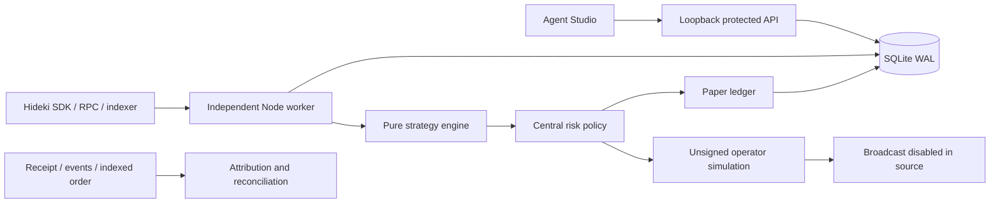

# Agent Studio architecture

The existing manual Planner and EIP-1193 wallet path remain separate. Agent Studio adds a lazy React screen, loopback API, independent Node worker and shared SQLite state. Strategies never import a signer.

| Path                                   | Responsibility                                                                                                                                          |
| -------------------------------------- | ------------------------------------------------------------------------------------------------------------------------------------------------------- |
| `packages/agent-engine/config.ts`      | Strict schema v1, revisioned configurations and safe illustrative defaults.                                                                             |
| `packages/agent-engine/index.ts`       | Pure deterministic completed-history evaluation and explanations.                                                                                       |
| `packages/agent-engine/paper.ts`       | Decimal ledger, adverse book fills, partials, resting orders, fees/funding and net outcomes.                                                            |
| `packages/agent-engine/history.ts`     | Actual candle prefixes, next observed bar fills, exploration/validation partitions.                                                                     |
| `packages/agent-risk`                  | Exact sizing and mandatory shared assessment.                                                                                                           |
| `packages/agent-execution`             | Official delegated ABI, permission reads, unsigned size/simulation/gas checks, review comparison and receipt reconciliation. Only MOCK dispatch exists. |
| `packages/agent-store`                 | Configs/versions, commands/acks, decisions/events, ledger, lease/fence, heartbeat, nonce/intents and reports.                                           |
| `apps/agent-worker/src`                | Environment schema, independent reads, lifecycle, fenced writes and health CLI.                                                                         |
| `apps/api/src/agents.ts`               | Local single-user config/history/export/permission/unsigned-preview adapter.                                                                            |
| `apps/web/src/components/agent-studio` | Accessible builder, overview, decisions, simulation, permissions and deployment.                                                                        |

## Persistence and control

API and worker share SQLite WAL with bound parameters, busy timeout and startup integrity/schema checks. Edits require expected revisions; configuration snapshots persist. Command UUIDs provide durable replay protection. Queueing and worker acknowledgement are separate events.

A global lease coordinates the shared database. A second process is refused even with the same worker ID. Renewals require the current fence and an unexpired lease. Replacement after expiry increments the fence. Evaluation commits recheck lease, current revision, pending pause/emergency and monotonic candle/block cursors **after** network I/O. Late results cannot persist fills after ownership/control changes.

Heartbeat/renewal runs every five seconds independently of bounded observations. Invalid data pauses the agent. Explicit resume refetches; it never assumes recovered state. Restart validates ledger/cursors and refuses unresolved intents. Corruption is not an empty account. An agent-store startup failure is isolated from existing manual API routes.

The worker uses existing SDK reconnect behavior plus fresh polling, not a separate WebSocket protocol. RPC identity and indexer freshness are checked; reconnect alone never authorizes stale data. This is a fail-closed polling design, not an exactly-once exchange guarantee.

## Authorization and evidence

SDK 0.32.1 lacks delegated `...For` writes. Exact signatures come from the pinned official bot kit with selector/direct-call suffix tests. `reduceOrderFor` shrinks a resting order, not a position.

Unsigned preflight checks owner/operator/pool, USDso system wiring, actual grants/STT, SDK size (`autoPull:false`), central policy, simulation, gas plus reserve and pending nonce. Grants are rechecked after I/O. Review pins calldata/expiry and material gas/nonce fields. No real signer is constructed.

MOCK-only tests persist intent before dispatch, serialize unresolved operator requests, reserve nonces and retain late hashes. Receipt reconciliation checks Hideki, sender/operator, owner argument, pool, exact calldata and indexed owner, then distinguishes official fill/rest/cancel evidence from indexer delay. Receipt success is not fill proof.

## Deployment/security limits

This is a local isolated control plane, not hosted authentication. Public owner addresses do not prove ownership. Hosted control needs authentication, owner/agent authorization, roles, encrypted operational metadata, audit/replay protection, secret isolation and worker revocation/version checks before ingress exists.

One replica and one SQLite volume are required. Independent databases cannot share fencing/nonces, and external applications are uncoordinated. Paper ledger/event growth needs retention planning. Database content is not encrypted (POSIX mode 0600; inherited Windows ACLs). No proven cloud uptime is claimed.
