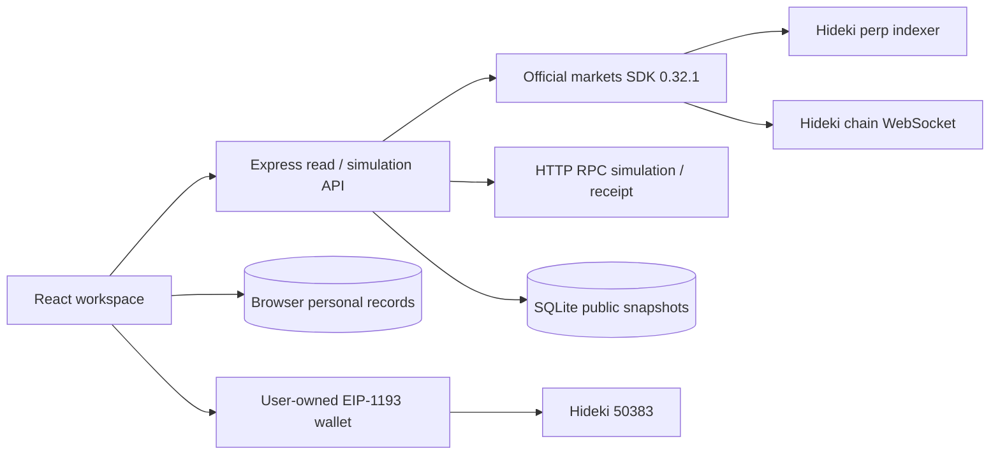

# PerpsHQ architecture

PerpsHQ is a local, testnet-only full-stack application. It has nine connected navigation destinations, with one selected market and timeframe across discovery, analysis and planning.

## Workspace

- `apps/web`: React 19, TypeScript, TanStack Query, Lightweight Charts 5, locally bundled open-source fonts, Lucide icons, responsive CSS.
- `apps/api`: Express 5, Zod validation, Helmet, rate limits, loopback host/origin checks. Read-only and unsigned simulation endpoints only.
- `packages/dreamdex-adapter`: SDK market discovery, chain reads, scoped candles, funding normalization, account state, encoding, preflight, receipt and indexed order reconciliation.
- `packages/market-data`: normalized candles, completed-bar policy, gap handling, compatible aggregation, request coalescing cache.
- `packages/indicator-engine`, `market-structure`, `opportunity-scoring`: pure deterministic calculations.
- `packages/risk-engine`: Decimal.js planning and exact bigint conversion.
- `packages/trade-planner`: lifecycle transitions, approval comparison, receipt outcome classification and planning context selection/snapshots.
- `packages/alert-engine` and `apps/web/src/useAlertMonitoring.ts`: deterministic per-rule evaluation and independent browser query scheduling.
- `apps/web/src/transaction.ts`: testable EIP-1193 dispatch, persisted intent, timeout and evidence matching.
- `packages/shared-types`: typed contracts across UI and API.

## Persistence

Personal watchlists, journal, plans, alerts, observed equity, overlay preferences, selected market, timeframe and transaction references persist in browser localStorage. No private keys or session secrets enter this store. Export journal/fills/evidence before clearing browser data. This is single-device persistence, not a multi-user hosted account service.

SQLite (`data/perpshq.sqlite`) stores public market snapshots and verified receipt evidence. WAL journaling is enabled. The directory is ignored by Git. Backend persistence does not accept unauthenticated journal mutations.

## Data flow and freshness

The SDK binds indexer data to Hideki. Candles are explicitly scoped by discovered perp pool and market ID, use each token’s decimals, and retain provenance. All source intervals have been observed returning actual candles. Missing periods are never interpolated. Indicators use the latest contiguous completed suffix, with explicit gap notes. A suffix older than two interval lengths after the last completed close is stale and disables technical interpretations.

Selected-market reads are cached/coalesced for 15–20 seconds; the UI polls every 30 seconds. Scans request at most four markets at once and refresh every 60 seconds. Account reads poll every 20 seconds. The SDK bounds indexer concurrency and retries. Chain reconnection is SDK-owned. No background delivery is promised while the browser is closed.

## Execution boundary

The server returns an unsigned transaction only after exact increment validation, official account sizing, system/collateral verification, RPC simulation and gas estimation. It cannot broadcast. The browser requires an explicit confirmation, checks chain/account again, revalidates the preview, and asks the injected wallet to sign. A persistent unresolved-submission lock prevents ordinary duplicate retries across reloads. Receipt recovery verifies transaction sender, pool and calldata. A transaction receipt and an order fill are separate facts.

## Scaling limits

This implementation binds to loopback. Publishing it requires deployment hardening, an authenticated user-data design if adding synchronization, secret-free environment configuration and a review of proxy/CSP/origin policy. Do not put a signer into this server. Independent account snapshots can describe different blocks; their timestamps are preserved and no exact portfolio liquidation is inferred from them.

## Readiness behavior

Each enabled market alert owns a market/timeframe query, deduplicated with the selected-market query. New alert reads have a two-request concurrency bound and a 60-second refresh interval. Account alerts observe account-query updates independently. Evaluations record checked/observed time and status, preserve the previous trigger while unavailable, and notify only on a new active condition. Rules/history retain their existing storage keys. Margin rules bind legacy records to the first usable account and then refuse another account. Browser closure/throttling interrupts monitoring.

Stale or fewer-than-50-bar history cannot generate directional support/resistance scenarios. Cached UI interpretations also expire after 90 seconds without a successful read. The Planner context panel offers explicit, side-aware draft references and an original snapshot stored additively with plans/journals. Existing records without these optional fields remain readable. Manual edits remove the corresponding reference attribution. Saving a plan or selecting a reference preserves its original context instead of replacing it with later reads.

Chart creation/subscription cleanup is separate from data updates. Existing candle/indicator series receive updates; disabled overlays are removed. Ordinary refreshes and overlay toggles preserve the visible time range. A market/timeframe change intentionally fits the newly selected history. Unmount/remount, browser reload and switching away from the chart start a new view; zoom is not persisted across navigation. When history disappears or an endpoint fails, existing unavailable/error behavior remains visible.

Before dispatch, fresh simulation must match the reviewed chain, account, target, calldata, value, gas/gas price, gas estimate, raw size/price, type and order ID. The server reuses approved order expiry rather than silently changing calldata. Wallet identity revisions and a Web Lock (when supported) guard dispatch; a persistent intent survives timeout, reload and account changes. A late returned hash is retained. Recovery requires exact calldata and a mined matching receipt, with a transaction-time bound when the original hash is unknown. A reverted receipt resolves an intent without implying a successful order. Indexer lag remains separate from transaction confirmation.
