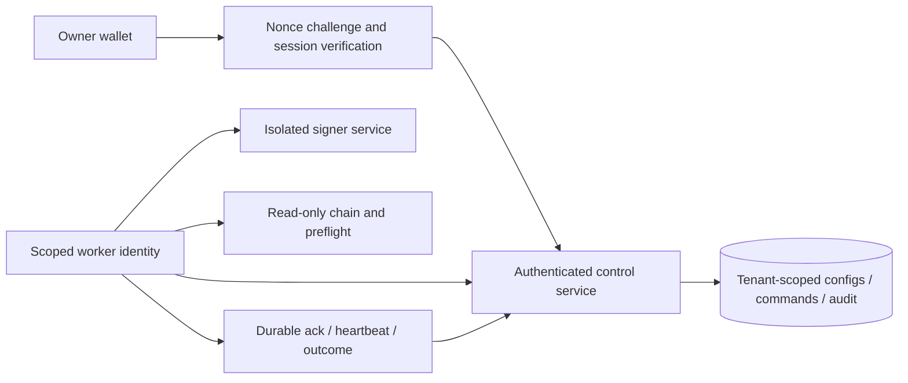

# Remote agent control architecture

## What works now

The functional local prototype is the existing Host/Origin-protected loopback API plus shared SQLite worker: versioned configs, UUID commands, durable queue, acknowledgements, heartbeat, audit events, fenced lease and explicit offline/requested/acknowledged status. It is single-user local control. No public endpoint, wallet authentication, hosted multi-user data separation, secret storage or remote Railway integration is implemented. The original API remains bound to 127.0.0.1.

The deployment tab correctly reports remote integration unavailable. A browser edit/export cannot affect a different machine's database. An authenticated implementation is substantial infrastructure and is deliberately deferred in favor of the bounty MVP.

## Proposed production boundary (conceptual)

This diagram is a design, not deployed code. The current worker still rejects signing secrets and all agent broadcasting remains disabled.

## Required contracts and controls

| Boundary             | Required behavior                                                                                                                                                                                                                                                                                               |
| -------------------- | --------------------------------------------------------------------------------------------------------------------------------------------------------------------------------------------------------------------------------------------------------------------------------------------------------------- |
| Wallet ownership     | Domain/origin/chain-bound one-use nonce challenge with issued/expiry time. Verify EOA signature or supported Somnia Account/EIP-1271 contract signature against the claimed owner and chain; an operator address or generic contract code is not owner authentication. Recheck after account/authority changes. |
| Browser session      | Secure HttpOnly SameSite cookies, short expiry/re-authentication for sensitive changes, CSRF and Origin checks, session revocation, rate limits and explicit domain binding. No signatures or tokens in localStorage/logs.                                                                                      |
| Tenant authorization | Every config/command/read joins authenticated owner to agent ownership in the database; deny cross-owner ID access. Public addresses cannot assign ownership. Roles distinguish observer, operator and owner administration.                                                                                    |
| Versioned config     | Strict schemas, immutable revision history/hash, compare expected revision in a DB transaction. Worker independently verifies tenant, market, chain, mode and approved hard limits. Editing cannot enable broadcast or clear emergency.                                                                         |
| Durable queue        | Command UUID, agent/owner, monotonic sequence, expected revision, issue/expiry, issuer and intent digest. Transactional enqueue; same UUID with different bytes rejected. Worker persists claim/ack, refuses gaps/replay/stale revisions and reports effect separately from receipt.                            |
| Worker identity      | Per-service scoped credentials or mTLS, bound to tenant/agent/worker/environment; rotation and revocation, not a global shared browser/API key. Worker cannot choose another owner by changing an export.                                                                                                       |
| Lease/fencing        | Shared transactional DB (for example Postgres) leases, server time and monotonically increasing fences; each result/submission commit validates current lease/control/config. SQLite replicas with independent volumes cannot coordinate.                                                                       |
| Secrets              | Separate managed signer/secret service; no main owner key, no secret in client/config exports/ordinary DB/image/URL. Narrow signing policy validates chain, destination, calldata, size, approval/fence and nonce independently.                                                                                |
| Heartbeat/status     | Authenticated sequenced worker heartbeat, actual last command/revision/fence and data ages. Offline is distinct from paused/acked. UI never infers a chain action from successful HTTP delivery.                                                                                                                |
| Audit/replay         | Append-only events with issuer/action/revision/command/outcome, no tokens. Encrypted storage/backups and tenant access policies. Signed message challenges and command IDs are single-use with bounded TTL.                                                                                                     |
| Network failure      | If current lease/control authorization cannot be renewed, stop new risk-increasing work. Discard stale asynchronous observations. Preserve unknown intents/nonces and reconcile before retry. Do not assume disconnection cancels chain orders.                                                                 |
| Emergency            | Owner command latches durably, invalidates new-order authorization and awaits worker acknowledgement; unknown/offline stays explicit. Immediate owner grant revocation/service stop is an out-of-band option requiring separate authorization and exposure review.                                              |

An execution request must satisfy both strategy/risk and independent current authorization. Never create an unauthenticated transaction route or reuse the loopback API as public ingress. Current no-broadcast source gate remains until separately reviewed and specifically authorized.

## Verification before hosting

Test challenge replay/wrong domain/chain/wallet, contract-wallet signature failure, session theft/revocation, CSRF, cross-tenant access, role escalation, stale revision/expired command, duplicate and out-of-order queue deliveries, worker credential substitution/revocation, split-brain fences, unknown nonces, pause during network I/O and outage recovery. Exercise DB backup/restore and ensure a restored worker cannot replay acknowledged actions. Review data retention, encryption, monitoring and incident response. Public deployment/paid resources and live canary require explicit owner approval; no cloud SLA or completed authentication is claimed by this design.
